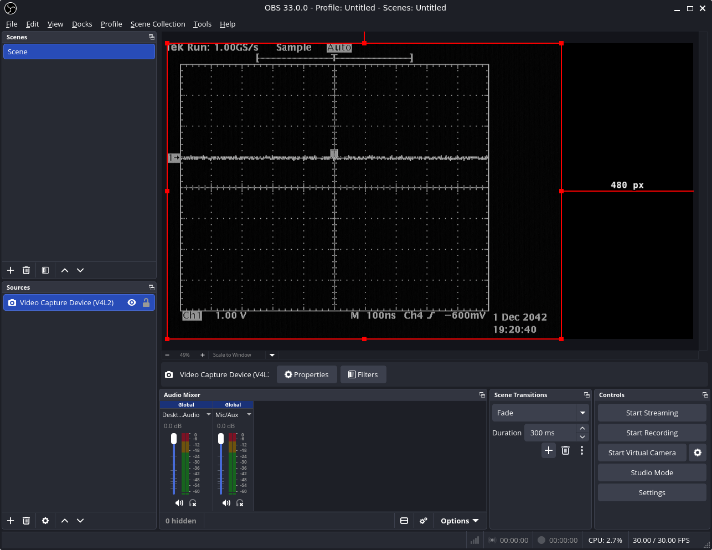
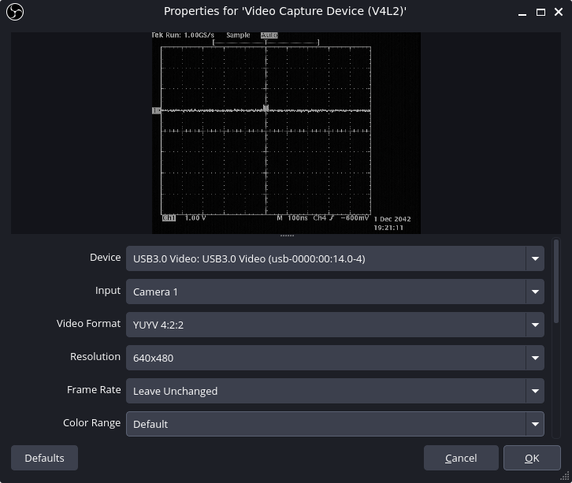

# Capturing Video from VGA Ports
For a planned project it is necessary to simultaneously capture VGA signals from multiple devices.

A market survey reveals that there exist interesting and inexpensive devices that can capture HDMI signals that can be acquired on the PC via USB.

This is the configuration:
- Tektronix TDS540A digital oscilloscope
- VGA to HDMI converter
- HDMI capture unit (with USB3 connection to computer)
- monitor

The PC is a Lenovo ThinkPad X390 running Ubuntu Linux 22.04LTS.

## Setting it up
For this project I installed OBS Studio (version 33.0.0) as Flatpak using the instructions given in https://marcelbootsman.nl/notes/installing-obs-on-ubuntu-the-easy-way-flatpak/ .

After attaching the USB video capture device we inspect the Kernel log:
```
cl@cl-ThinkPad-X390:~$ sudo dmesg | tail -n 20
[392077.615236] usb 2-4: new SuperSpeed USB device number 8 using xhci_hcd
[392077.640832] usb 2-4: LPM exit latency is zeroed, disabling LPM.
[392077.663513] usb 2-4: New USB device found, idVendor=345f, idProduct=2131, bcdDevice=31.00
[392077.663539] usb 2-4: New USB device strings: Mfr=1, Product=2, SerialNumber=3
[392077.663549] usb 2-4: Product: USB3.0 Video
[392077.663556] usb 2-4: Manufacturer: MACROSILICON
[392077.663563] usb 2-4: SerialNumber: XXXXXXXX
[392077.682307] usb 2-4: Found UVC 1.00 device USB3.0 Video (345f:2131)
[392077.742816] hid-generic 0003:345F:2131.001D: hiddev0,hidraw0: USB HID v1.10 Device [MACROSILICON USB3.0 Video] on usb-0000:00:14.0-4/input4
```

```
cl@cl-ThinkPad-X390:~$ ls -l /dev/video*
crw-rw----+ 1 root video 81, 0 Sep  2 16:57 /dev/video0
crw-rw----+ 1 root video 81, 1 Sep  2 16:57 /dev/video1
crw-rw----+ 1 root video 81, 2 Okt 25 12:02 /dev/video2
crw-rw----+ 1 root video 81, 3 Okt 25 12:02 /dev/video3
cl@cl-ThinkPad-X390:~$ sudo adduser cl video
Adding user `cl' to group `video' ...
Adding user cl to group video
Done.
```
This change of group membership becomes effective only the next time you login.

At the time of this writing, it was not possible to re-login. Therefore as temporary workaround, I adjusted the group of the `video*` inodes. A different, more granular approach would be to use the `udev` mechanism to define permissions based on the hardware. With `udev` it is even possible to define a unique name attached to a physical device based on its serial number (for instance, if you operate multiple USB-to-Serial converters, the device names in `/dev` will remain stable when they are attached in a different sequence)

## Running OBS Studio
Launching OBS Studio (there is no need to run `flatpak override --device=all com.obsproject.Studio` before, this command gives 'error: Permission denied'):
```
cl@cl-ThinkPad-X390:~$ flatpak run com.obsproject.Studio
```

In the "Sources" section (in the lower left), click "+" button and add the "Video Capture Device (V4L2)".

## Pictures


